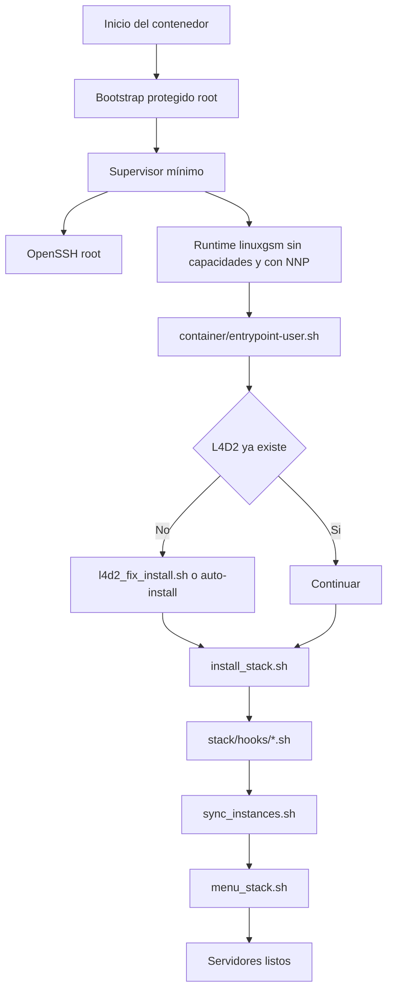
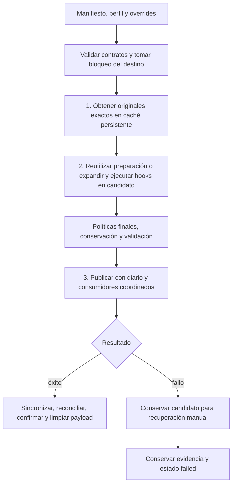

# Diagramas de Flujo del Sistema

## Flujo completo de arranque

## Flujo del stack

Instalación y actualización comparten este flujo. Una publicación interrumpida
se recupera bajo el mismo bloqueo antes de preparar otra. No se limpia el stack
operativo antes de descargar. Véase [el contrato completo](artifact-flow.md).

## Mapa conceptual

### Bootstrap

- `container/root/bootstrap.py` (entrypoint protegido de la imagen)
- `container/runtime.py` (supervisor sin privilegios)
- `container/entrypoint.sh` (wrapper de compatibilidad)
- `container/bootstrap/dependencies_check.sh`
- `container/bootstrap/ssh.sh`
- `container/bootstrap/symlink.sh`

### Installer

- `installer/bin/install_stack.sh`
- `installer/bin/sync_instances.sh`
- `installer/bin/menu_stack.sh`
- `installer/bin/l4d2_fix_install.sh`
- `installer/lib/tools_stack.sh`

### Stack

- `stack/manifests/components.json`
- `stack/profiles/*.json`
- `stack/hooks/*.sh`
- `stack/preserve-paths.json`

## Notas de migracion

Los diagramas antiguos del modelo repo-centrico ya no representan el flujo vigente. Ese modelo fue sustituido por:

- `install_stack.sh`
- `stack/hooks/`
